# 拾录 · 记录、计划、阅读与技术资源工作台

一个本地优先的个人工作台：**通用记录**负责保存事实、问答、根因与需求；**计划管理**负责把目标拆成节点、记录实际时间与进度变化；**书籍与文档**负责收拢书、论文、文章、技术规范与办公材料；**仓库管理**负责整理代码仓库、编程语言、资源地址与关联品；**工具管理**负责归档开发工具、支持平台、开源状态与关联品。五个子系统拥有独立的代码目录和独立的 SQLite 数据库。

当前版本：**v1.5**（新增仓库管理与工具管理子系统：`repository.db`、`tools.db`、资源地址三表模型、编程语言/支持平台、标签、关联品，以及 Markdown 描述与评价）。


## 快速开始

### Windows 一键启动

双击项目根目录的 **`start.bat`**。

脚本会：

1. 检查 Python 3.10+；
2. 检查前端构建产物 `dist/index.html`（缺失时自动执行 `npm install` + `npm run build`）；
3. 启动后端；默认使用 `config.json` 的端口并打开浏览器（初始为 <http://127.0.0.1:8765>）。

关闭窗口或按 `Ctrl+C` 即可停止服务。同一个端口只允许运行一个实例；第二个实例会明确报错。

> 不需要执行 `pip install`。后端只使用 Python 标准库。首次启动会读取根目录 `config.json`，并自动创建：
>
> - `data/records.db`（通用记录）
> - `data/plans.db`（计划管理）
> - `data/docs.db`（书籍与文档）
> - `data/repository.db`（仓库管理）
> - `data/tools.db`（工具管理）

五个数据库互不共享领域表、标签或外键。

### 手动启动

```bash
python server.py
```

可选参数（优先级高于环境变量与 `config.json`）：

```bash
python server.py --config D:\configs\grs.json --port 8790 \
  --db data/my-records.db --plan-db data/my-plans.db \
  --docs-db data/my-docs.db \
  --repository-db data/my-repository.db --tools-db data/my-tools.db --open
```

### 启动配置文件

项目根目录的 **`config.json`** 是默认启动配置：

```json
{
  "host": "127.0.0.1",
  "port": 8765,
  "records_db": "data/records.db",
  "plans_db": "data/plans.db",
  "docs_db": "data/docs.db",
  "repository_db": "data/repository.db",
  "tools_db": "data/tools.db",
  "open_browser": true,
  "debug": false
}
```

| 字段 | 类型 | 说明 |
| --- | --- | --- |
| `host` | string | 监听地址；默认 `127.0.0.1`，只建议本机使用 |
| `port` | 1–65535 | 服务端口 |
| `records_db` | string | 通用记录 SQLite 路径 |
| `plans_db` | string | 计划管理 SQLite 路径 |
| `docs_db` | string | 书籍与文档 SQLite 路径 |
| `repository_db` | string | 仓库管理 SQLite 路径 |
| `tools_db` | string | 工具管理 SQLite 路径；五个数据库必须指向不同文件 |
| `open_browser` | boolean | 启动后是否自动打开浏览器 |
| `debug` | boolean | 是否在后端控制台打印异常堆栈 |

规则：

- `config.json` 中的相对路径按**配置文件所在目录**解析；例如放在项目根目录时，`data/records.db` 就是项目内路径。
- 支持 UTF-8 与 UTF-8 BOM（Windows 记事本 / PowerShell 保存的 BOM 不会导致启动失败）。
- 未知字段、非法 JSON、端口越界、任意两个数据库相同都会明确报错并退出，不会静默回退。
- `start.bat` 默认读取根目录 `config.json`；`--no-open` 只关闭本次浏览器打开动作。
- 手动启动可用 `--config other.json` 指定其他配置文件；`start.bat` 固定读取根目录配置。

优先级从高到低：

```text
命令行参数 > GRS_* 环境变量 > config.json > 内置默认值
```

| 环境变量 | 覆盖字段 |
| --- | --- |
| `GRS_HOST` | `host` |
| `GRS_PORT` | `port` |
| `GRS_DB` | `records_db` |
| `GRS_PLAN_DB` | `plans_db` |
| `GRS_DOCS_DB` | `docs_db` |
| `GRS_REPOSITORY_DB` | `repository_db` |
| `GRS_TOOLS_DB` | `tools_db` |
| `GRS_OPEN_BROWSER` | `open_browser`（1/0、true/false、yes/no、on/off） |
| `GRS_DEBUG` | `debug`（同上） |

### 修改端口 / 数据库

推荐直接编辑 `config.json`。如果不希望改动文件，可以用环境变量临时覆盖：

```bat
set GRS_PORT=8790
set GRS_DB=D:\data\my-records.db
set GRS_PLAN_DB=D:\data\my-plans.db
set GRS_DOCS_DB=D:\data\my-docs.db
set GRS_REPOSITORY_DB=D:\data\my-repository.db
set GRS_TOOLS_DB=D:\data\my-tools.db
start.bat
```

`start.bat --no-open` 只启动服务、不打开浏览器，适合脚本或调试。

### 启动错误的排查

配置错误时服务会在启动阶段打印 `[ERROR] Invalid startup configuration: ...`，不会带着错误端口或数据库继续运行。常见原因：

- JSON 缺少引号 / 多了一个逗号；
- 写了不支持的字段（例如把 `records_db` 写成 `record_db`）；
- `port` 超出 1–65535；
- `records_db`、`plans_db`、`docs_db`、`repository_db`、`tools_db` 中任意两个指向同一个文件。

## 主页面与导航

- `/` 是固定主页面：展示通用记录、计划管理、书籍与文档、仓库管理、工具管理五个子系统入口与各自统计。
- 侧边栏始终包含 **「主页面」**。
- 进入通用记录后，侧边栏切换为记录类型、标签库、标签模糊搜索、类型管理。
- 进入计划管理后，侧边栏切换为计划总览、长远/中期/短期计划、计划标签、标签模糊搜索。
- 进入书籍与文档后，侧边栏切换为文档总览、五类默认文档、文档标签、标签模糊搜索、类型管理。
- 进入仓库管理后，侧边栏切换为仓库列表、编程语言管理、仓库标签管理、标签模糊搜索。
- 进入工具管理后，侧边栏切换为工具列表、支持平台管理、工具标签管理、标签模糊搜索。
- 桌面端与移动端均支持；桌面端点击左上角折叠按钮可收起/展开侧边栏，移动端侧边栏以遮罩抽屉方式展开。


## 通用记录

- **自定义记录类型**：运行时新建类型，定义任意一组有序字段。
- **动态记录表单**：按类型字段顺序渲染输入区，支持 Markdown 编辑与实时预览。
- **全局标签系统**：一条记录可绑定多个标签；标签跨记录类型共享。
- **标签库 / 标签筛选**：按名称或数量排序；多标签使用 **AND** 语义。
- **标签模糊搜索**：列表筛选栏支持多个关键词（空白分隔，AND），每个关键词对标签名做包含匹配；`/tag-search/{query}` 跨全部记录类型搜索，可与精确标签筛选组合。
- **安全 Markdown**：支持 GFM 表格、任务列表、代码块与 KaTeX 数学公式；原始 HTML 作为文本展示。
- **标题预览**：列表 48 字符、详情 100 字符，超出显示 `...`，悬浮显示完整标题。
- **复制**：详情顶部复制完整 Markdown，每个字段独立复制；空字段禁用。
- **记录管理**：新建、查看、编辑、删除；标题与字段内容分别搜索、按精确标签或模糊标签过滤。
- **类型管理**：重命名、增删字段、调整顺序；删除前有数据丢失警告。
- **孤立标签清理**：只删除不再被任何记录使用的标签。

## 计划管理

### 三类计划

| 类型 | 时间尺度 | 页面 |
| --- | --- | --- |
| 长远计划 | 季度 / 年度，方向与结构性目标 | `/plans/long` |
| 中期计划 | 月度，阶段交付 | `/plans/mid` |
| 短期计划 | 周 / 日，下一件具体的事 | `/plans/short` |


### 计划属性

- 标题、Markdown 内容、创建/更新时间
- 预估耗时、实际耗时（小时，支持两位小数）
- 计划开始 / 结束时间线
- 状态、进度、完成度
- 一级父计划（可挂到一个父计划下；父计划不能再有父计划）
- 独立计划标签（三表模型：`plans` + `plan_tags` + `plan_tag_links`）

### 状态与流转

| 当前状态 | 允许变为 |
| --- | --- |
| 进行中 | 完成 / 放弃 / 超时 / 搁置 |
| 搁置 | 进行中 / 放弃 |
| 超时 | 进行中 / 完成 / 放弃 |
| 完成 | 进行中（重新打开，留审计） |
| 放弃 | 进行中（重新打开，留审计） |

- 「变更转移」本期不实现；需要转移时使用「放弃 + 原因」。
- 完成前要求所有未放弃节点已完成；状态变为完成时，进度自动补齐到 100%。
- 放弃、搁置、超时必须填写原因；每次状态变化都写入状态历史。
- 完成 / 放弃为终态，编辑、节点与进度操作会被锁定；重新打开后可继续。

### 时间节点、实际时间点与进度

- **节点**：名称、计划起止、权重、状态（未开始/进行中/完成/放弃）、单个前置依赖。
- **完成度**：未放弃节点按权重汇总；没有节点时等于进度。
- **实际时间点**：关联节点、实际起止、描述、证据/附件说明；系统计算时长。
- **进度历史**：时间、变化度（百分比，可为负）、描述、类型（进度变化/阻塞/困难）、证据。
- 进度是历史变化按时间顺序累计并限制在 0–100；每条记录保存 `progress_after`，删除或回退后可重新计算。
- 阻塞/困难可以记录 0% 变化，用于保留上下文。

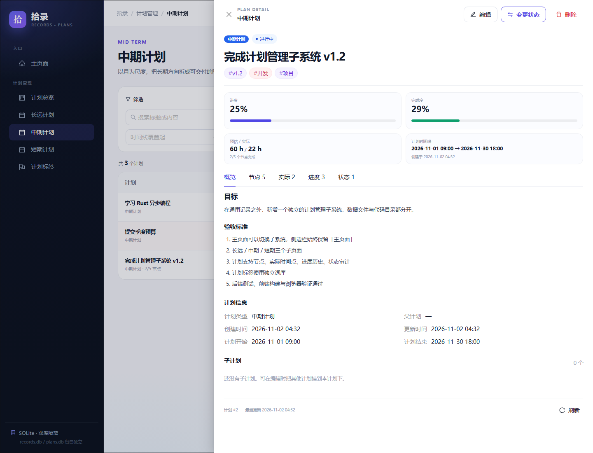

### 筛选与标签

- 标题关键词与内容关键词分开搜索
- 状态多选
- 计划标签多选（AND）
- 标签模糊搜索（多个关键词空白分隔，AND；标签名包含关键词即可命中）
- 进度区间
- 计划时间线覆盖范围
- 排序：最近更新/创建、计划开始/结束、进度、预估/实际耗时
- 计划标签页：独立词库、数量统计、名称/数量排序、模糊搜索、按计划类型筛选、孤立标签清理
- `/plans/tag-search/{query}`：跨长远/中期/短期计划按标签模糊搜索

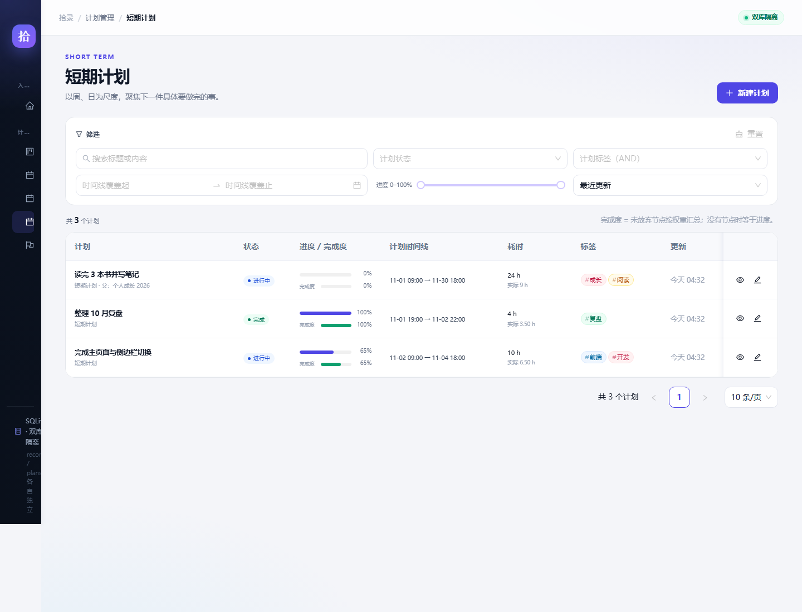

### 新建计划

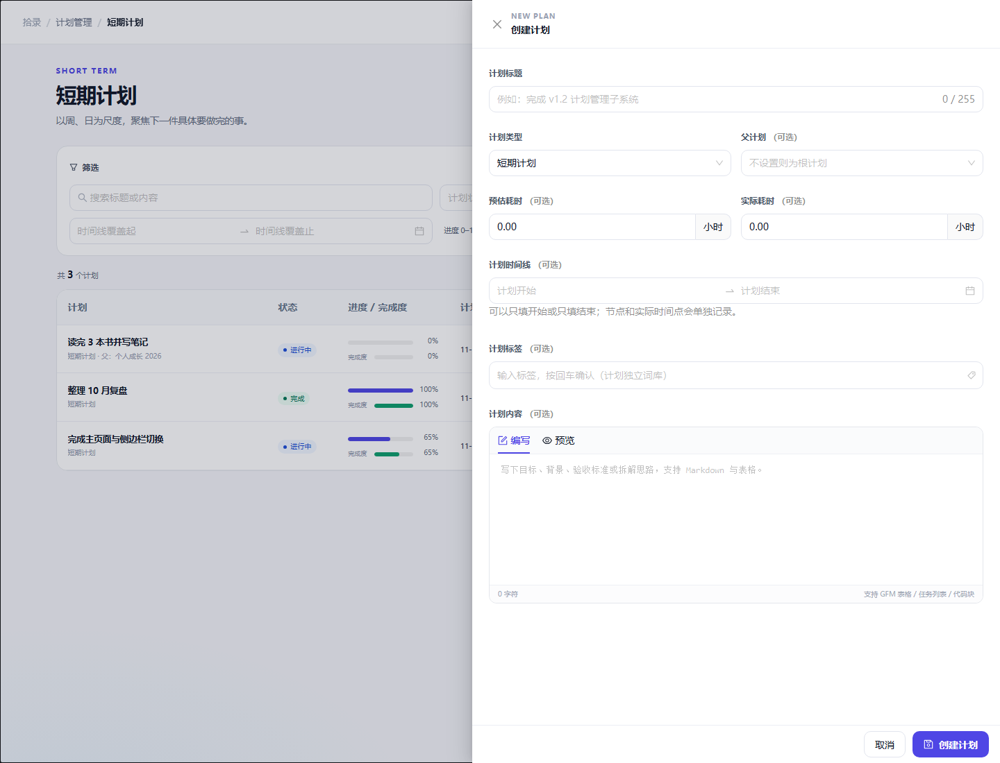

## 书籍与文档

### 默认类型与页面

| 类型 | 页面 | 说明 |
| --- | --- | --- |
| 书籍 | `/docs/type/1` | 纸质书、电子书与长篇阅读 |
| 论文 | `/docs/type/2` | 学术论文、研究报告与文献 |
| 文章博客日志 | `/docs/type/3` | 博客、专栏、公众号与日志 |
| 技术与规范类文档 | `/docs/type/4` | 技术文档、API、标准与规范 |
| 商业与办公类文档 | `/docs/type/5` | 商业报告、方案、合同与办公材料 |

- `/docs`：文档总览，含类型分布、阅读状态、正在读、最近更新与累计阅读历史。
- `/docs/type/{id}`：某个类型的文档列表，支持关键词、状态、优先级、阅读进度区间、标签（AND）与排序。
- `/docs/tags/{tag}`：跨全部文档类型按精确标签筛选。
- `/docs/tag-search/{query}`：跨全部文档类型按标签模糊搜索；多个关键词空白分隔并 AND。
- `/docs/new?type={id}`：编辑页，新建文档。
- `/docs/{id}`：浏览内容页整页路由（用于深链与刷新），展示笔记、感想、文档信息、标签与默认折叠的阅读历史；从列表与总览点击时改为打开悬浮抽屉，不再整页跳转。
- `/docs/{id}/edit`：编辑页，修改全部字段并管理多次阅读历史。
- `/docs/types`：类型管理，可新增、改名、改描述；类型下仍有文档时拒绝删除。
- `/docs/tags`：文档标签管理，独立三表词库，支持按文档类型筛选、重命名、删除与孤立标签清理。


### 文档属性

- 文档名称、所属类型（必填）。
- 文档信息：`作者`、`时间`、`版本`、`资源地址`、`其它信息` 是**独立字段**，可分别筛选。
- 列表查看时，每个非空字段独占一行；空字段不显示，超长显示 `...`，悬浮显示完整内容。
- 资源地址显示为可点击的「资源地址」链接，在新标签页打开；原 URL 放在悬浮提示中。
- 文档信息筛选：作者、时间、版本、资源地址、其它信息各有一个子串筛选输入框。
- 文档库不实现结构自动迁移；`docs.db` 按新结构创建。
- 阅读状态：未阅读 / 进行中 / 完成；阅读进度 0–100%；优先级 1–5。
- 阅读笔记与阅读感想：分别保存，均支持 Markdown / GFM。
- 文档标签：`documents` + `doc_tags` + `doc_tag_links` 三表模型；列表不单独设标签列，标签在标题下方按行宽自动换行并完整显示。
- 阅读历史：开始时间、结束时间、耗时（小时）、描述，全部可选；浏览内容页默认折叠。

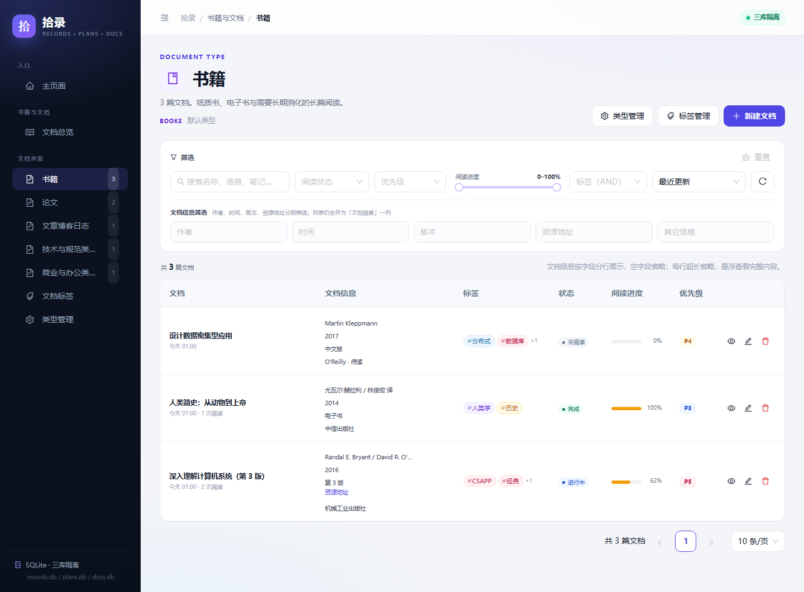

### 浏览内容页

浏览内容页与编辑页分离。顶部展示类型、状态、优先级、标签与阅读 KPI；主体分为阅读笔记、阅读感想、阅读历史，右侧显示完整文档信息与元数据。

在文档列表或总览中点击标题、眼睛按钮、“正在读”或“最近更新”行时，详情以右侧悬浮抽屉打开，不再像网页跳转一样离开当前列表：

- 抽屉宽度为侧边栏右侧的完整内容区（`calc(100vw - 侧边栏宽度)`）；桌面展开侧边栏时为 252px 右侧的剩余宽度，侧边栏折叠或移动端时为 100vw；
- 遮罩从侧边栏右边缘开始，侧边栏保持可见、可点击；抽屉右上角有关闭按钮，`Esc` 或点击遮罩也可关闭；
- 关闭后列表的关键词、筛选条件、分页与滚动位置保持不变；
- 抽屉内可直接编辑、删除、刷新或点击标签筛选；编辑与标签操作会先关闭抽屉再跳转，删除成功后关闭抽屉并重新加载列表或总览统计；
- `/docs/{id}` 整页路由继续保留，用于直接访问、刷新以及从编辑页保存后返回。

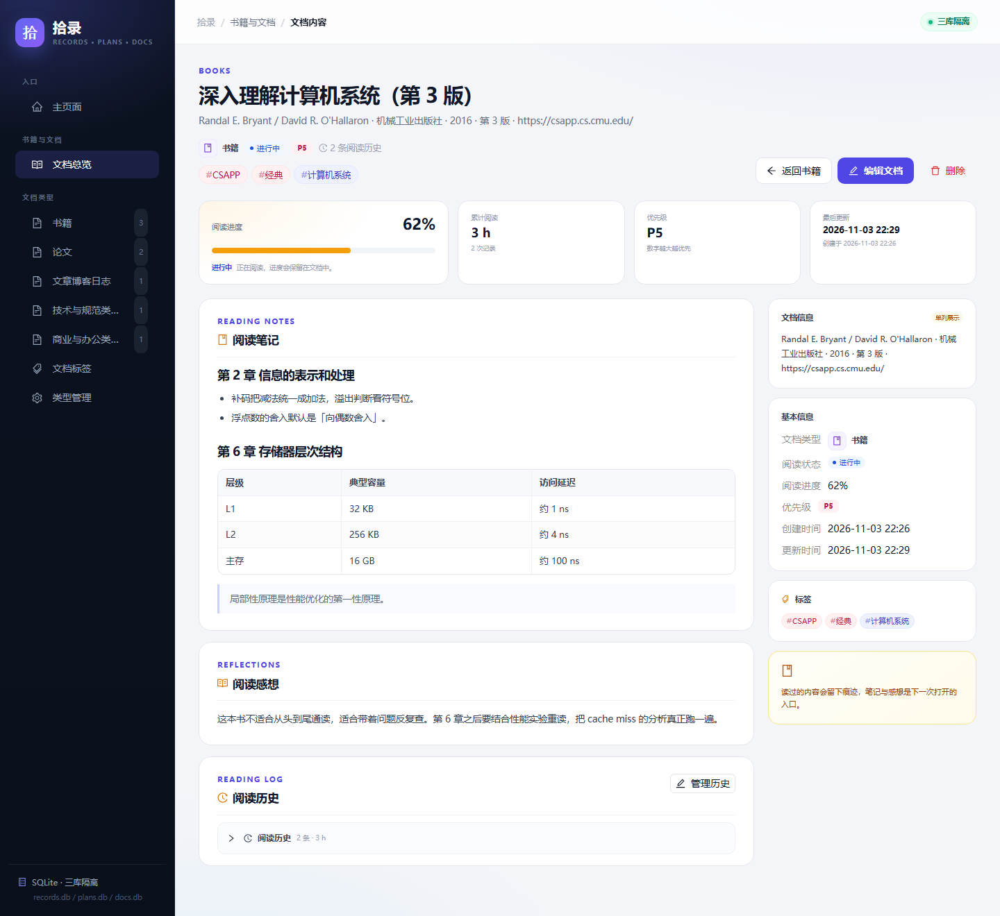

阅读历史默认折叠，点击后按开始时间倒序展示每次阅读的时间段、耗时和描述。

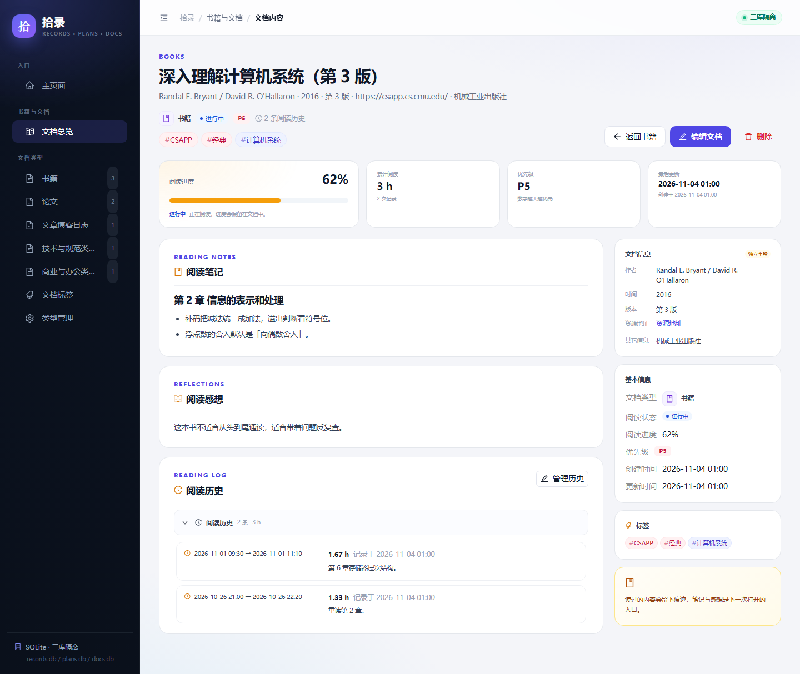

### 编辑页

编辑页集中维护基本信息、文档信息、标签、笔记、感想与阅读历史。阅读历史可添加任意多次；结束时间不能早于开始时间，耗时支持两位小数。

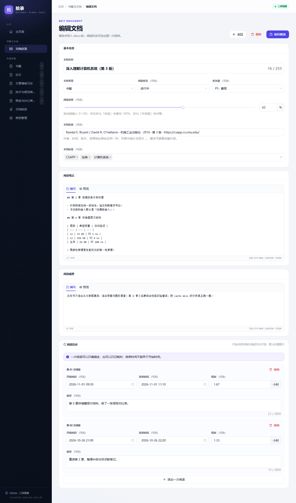

### 类型与标签管理

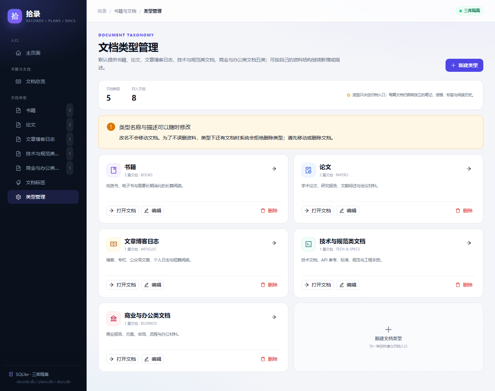

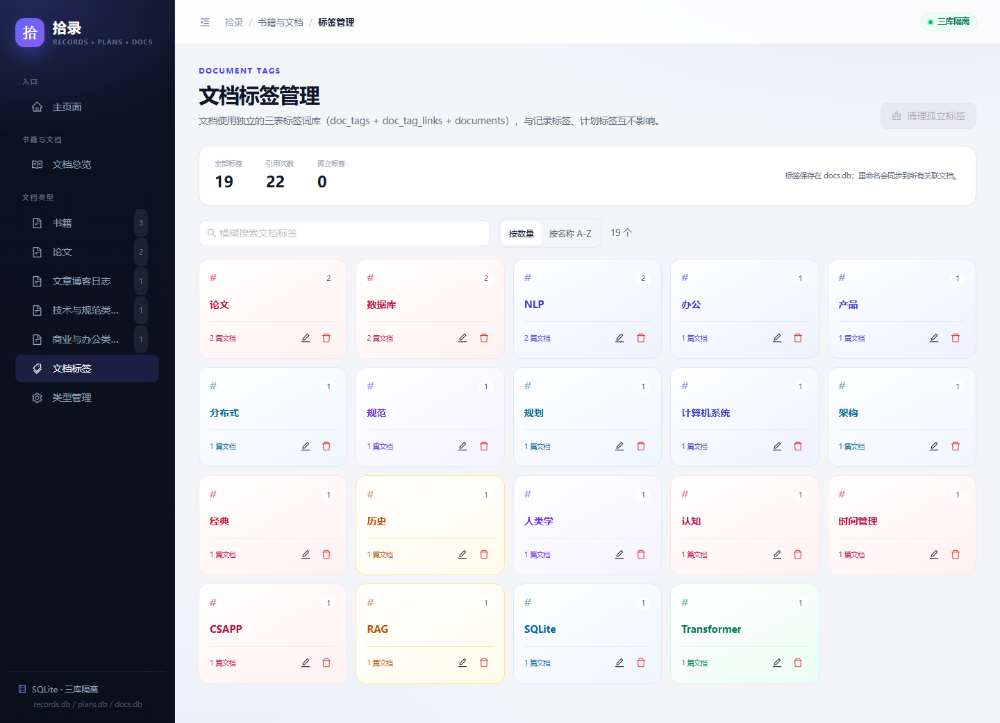

## 仓库管理

仓库管理使用独立数据库 `repository.db`，与记录、计划、文档、工具完全隔离。

### 仓库属性

- 仓库名称、仓库描述、评价（优点 / 缺点）。
- 描述与评价支持 **Markdown**：编辑时提供「编写 / 预览」，查看详情时按 Markdown 渲染。
- 编程语言：独立词库 `repository_languages` + 关联表 `repository_language_links`，内置 Python、JavaScript、TypeScript、Java、Go、Rust、C/C++、C#、PHP、Ruby、Swift、Kotlin、SQL、Shell 等常用语言。
- 仓库标签：三表模型 `repositories` + `repository_tags` + `repository_tag_links`，与其它子系统的标签词库互不共享。
- 资源地址列表：`repository_resources` 保存多个 `id / 资源地址名称 / 资源地址`，支持增删与排序。
- 关联品（相似品 / 替代品等）：`repository_relations` 通过其它仓库 ID 关联，保存关联描述；添加时可**按仓库名称模糊搜索**。

### 页面

| 页面 | 路径 | 说明 |
| --- | --- | --- |
| 仓库列表 | `/repositories` | 搜索、标签/语言 AND 筛选、标签模糊搜索、排序、分页 |
| 编程语言管理 | `/repositories/languages` | 新增、重命名、删除语言；点击语言卡片筛选仓库 |
| 仓库标签管理 | `/repositories/tags` | 新增、重命名、删除、清理孤立标签；点击标签卡片筛选仓库 |
| 仓库标签模糊搜索 | `/repositories/tag-search` | 跨全部仓库按标签名包含关键词搜索（多关键词 AND） |

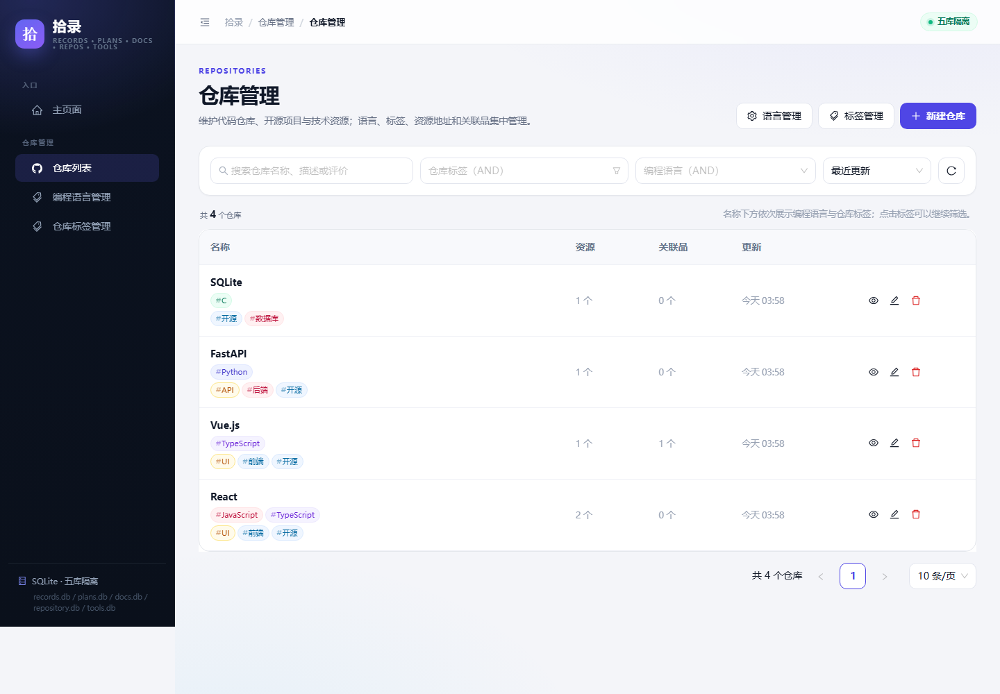

列表行为：

- 名称列下方固定两行：第一行编程语言，第二行仓库标签。
- 点击语言或标签即可加入筛选；再次点击取消。
- 标签筛选支持模糊搜索，多选为 **AND** 语义。
- 列表筛选栏提供独立的模糊标签输入框：多个关键词空白分隔，每个关键词对标签名做包含匹配，全部关键词需同时命中。
- 描述不在列表展示，避免在表格中渲染 Markdown；名称搜索与「描述 / 评价」搜索相互独立。
- 详情抽屉展示完整信息、Markdown 描述与评价、可点击资源地址、语言/标签和关联品。

新建 / 编辑仓库时：

- 标签与语言使用可搜索的多选框，输入后可直接创建新项；
- 资源地址通过「添加资源地址」逐条维护；
- 关联品通过模糊搜索选择另一个仓库，并填写关联描述；
- 仓库不能关联自己。

## 工具管理

工具管理使用独立数据库 `tools.db`，与其它四个数据库完全隔离。

### 工具属性

- 工具名称、工具描述、评价（优点 / 缺点），描述与评价支持 **Markdown**。
- 是否开源：布尔标记，列表与详情均展示「开源 / 闭源」。
- 支持平台：独立词库 `tool_platforms` + 关联表 `tool_platform_links`，内置 Windows、Linux、macOS、Android (APK)、Web、iOS，可在管理页增删改；一个工具可多选平台。
- 工具标签：三表模型 `tools` + `tool_tags` + `tool_tag_links`。
- 资源地址列表：`tool_resources`，每条保存名称与地址。
- 关联品（相似品 / 替代品等）：`tool_relations` 通过其它工具 ID 关联，支持按工具名称模糊搜索并填写关联描述。

### 页面

| 页面 | 路径 | 说明 |
| --- | --- | --- |
| 工具列表 | `/tools` | 搜索、标签/平台 AND 筛选、标签模糊搜索、排序、分页 |
| 支持平台管理 | `/tools/platforms` | 新增、重命名、删除平台；点击平台卡片筛选工具 |
| 工具标签管理 | `/tools/tags` | 新增、重命名、删除、清理孤立标签；点击标签卡片筛选工具 |
| 工具标签模糊搜索 | `/tools/tag-search` | 跨全部工具按标签名包含关键词搜索（多关键词 AND） |

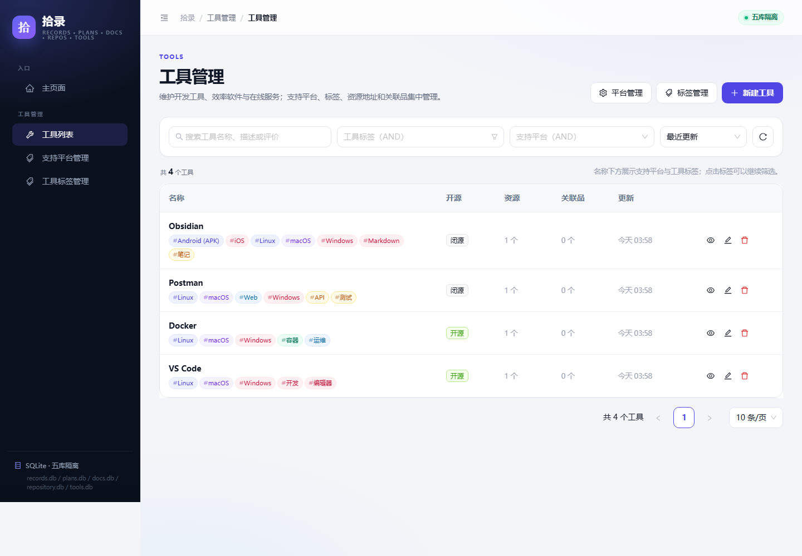

列表行为：

- 名称列下方固定一行，展示支持平台与工具标签。
- 点击平台或标签即可加入筛选；再次点击取消；多选为 **AND** 语义。
- 列表筛选栏提供独立的模糊标签输入框：多个关键词空白分隔，每个关键词对标签名做包含匹配，全部关键词需同时命中。
- 描述不在列表展示；名称搜索与「描述 / 评价」搜索相互独立。
- 详情抽屉展示开源状态、Markdown 描述与评价、资源地址、平台/标签和关联品。

新建 / 编辑工具时：

- 支持平台与标签都是可搜索的多选框，输入后可直接创建新项；
- 平台多选，标签多选；
- 工具不能关联自己。

## Markdown 与数学公式

所有子系统的 Markdown 内容（记录字段、计划内容、文档笔记/感想、仓库与工具的描述/评价）都通过同一渲染组件 `src/components/Markdown.jsx` 输出，支持 GFM 与 LaTeX 数学公式。

| 写法 | 位置 | 示例 |
| --- | --- | --- |
| `$...$` | 行内公式 | `$\Delta W = W_{偏移} - W_{复位}$` |
| `$$...$$` | 块级公式 | `$$\Delta W = W_{偏移} - W_{复位}$$` |
| `\(...\)` | 行内公式（Pandoc/LaTeX 习惯） | `\(\Delta W = W_{偏移} - W_{复位}\)` |
| `\[...\]` | 块级公式（Pandoc/LaTeX 习惯） | `\[\Delta W = W_{偏移} - W_{复位}\]` |

- 渲染链路：`react-markdown` + `remark-math` + `rehype-katex` + KaTeX 样式。
- 构建时仅保留 woff2 数学字体（`vite.config.js` 的 `katexWoff2Only` 插件剔除 woff/ttf），面向现代浏览器，`dist/assets` 字体约 250 KB。
- `\(...\)` / `\[...\]` 会先由 `normalizeMathDelimiters` 归一化为 `$...$` / `$$...$$`，再交给 `remark-math`。
- 围栏代码块与行内代码中的 LaTeX 写法保持原样，不会被当作公式。
- 公式解析失败时以红色错误文本展示，不影响页面其余内容。
- 需要字面 `\[`（例如 LaTeX 的 `\\[2pt]` 换行参数）时，反斜杠需成对书写或放入代码块。

## 技术栈

| 层 | 选型 |
| --- | --- |
| 前端 | React 18、Ant Design 5、Vite 5 |
| Markdown | react-markdown + remark-gfm + remark-math + rehype-katex（KaTeX） |
| 后端 | Python 3.10+ 标准库（`http.server` + `sqlite3`） |
| 数据库 | SQLite（WAL 模式），记录库、计划库、文档库、仓库库、工具库五库分离 |
| 部署 | 前端构建为 `dist/`，由 Python 后端同源托管 |

后端刻意不依赖 FastAPI/Flask：本工具是单用户本地应用，标准库足够，能做到“装好 Python 就能启动”。

## 目录结构

```text
.
├─ server.py                    # HTTP 路由、静态托管、启动入口
├─ config.json                  # 启动配置：端口、五个数据库、浏览器、调试
├─ .env.example                 # 数据发布配置模板（复制为 .env，.env 不入库）
├─ backend/
│  ├─ common.py                 # 路径、校验、SQLite session
│  ├─ config.py                 # config.json + GRS_* 覆盖与校验
│  ├─ records/store.py          # 通用记录数据层（records.db）
│  ├─ plans/store.py            # 计划数据层（plans.db）
│  ├─ docs/store.py             # 书籍与文档数据层（docs.db）
│  ├─ repositories/store.py     # 仓库管理数据层（repository.db）
│  └─ tools/store.py            # 工具管理数据层（tools.db）
├─ src/
│  ├─ shell/                    # AppShell、主页面、动态导航、AppDataContext
│  ├─ subsystems/
│  │  ├─ records/               # 记录页面与记录专属组件
│  │  ├─ plans/                 # 计划页面、API、表单/详情/弹窗
│  │  ├─ docs/                  # 文档页面、API、类型/标签/阅读历史组件
│  │  ├─ repositories/          # 仓库列表、语言/标签管理、表单与详情
│  │  └─ tools/                 # 工具列表、平台/标签管理、表单与详情
│  ├─ components/               # 跨子系统共享组件（Markdown、标题、标签、
│  │                            # 模糊标签选择、资源地址与关联品编辑器等）
│  ├─ api.js                    # 记录 API + 通用 request
│  ├─ router.js / utils.js      # 哈希路由与格式化
│  └─ styles.css                # 全局与五个子系统的样式
├─ dist/                        # 构建产物（由后端托管）
├─ data/                        # 五个 .db 文件（运行时生成）
├─ tests/
│  ├─ test_api.py               # 记录子系统 18 项测试
│  ├─ test_plans.py             # 计划子系统 19 项测试
│  ├─ test_docs.py              # 书籍与文档 16 项测试
│  ├─ test_repositories.py      # 仓库管理 4 项测试
│  ├─ test_tools.py             # 工具管理 4 项测试
│  └─ test_config.py            # 启动配置 8 项测试
├─ scripts/
│  ├─ publish_data_release.py   # data/ 快照上传到 GitHub Releases
│  ├─ install_git_hooks.ps1     # 安装 post-commit 钩子
│  └─ git-hooks/post-commit     # 本地 commit 后自动发布
├─ docs/screenshots/            # 桌面与移动端截图
├─ doc/                         # 开发特性说明（dev-feat-*.md）
├─ requirement.md               # 需求、风险、建模、派生需求、资格策略
├─ bug-tracks.md                # 开发缺陷记录
└─ start.bat                    # Windows 一键启动
```

## 数据模型

### records.db

```text
record_types 1 ─── n type_fields
      │                  │
      ▼ n                ▼ n
   records 1 ─── n record_field_values
      │
      ▼ n
    tags  ←── record_tags
```

### plans.db

```text
plans 1 ─── n plan_nodes
  │            │
  │            └── n plan_actuals
  ├── n plan_progress_logs
  ├── n plan_status_logs
  └── n plan_tag_links ─── plan_tags
```

### docs.db

```text
doc_types 1 ─── n documents 1 ─── n doc_reading_history
                        │
                        └── n doc_tag_links ─── doc_tags

documents: title / author / doc_time / version / resource_url /
           document_info（其它信息） / notes / reflections /
           reading_status / reading_progress / priority
```

### repository.db

```text
repositories 1 ─── n repository_resources
      ├── n repository_relations ─── repositories（关联目标）
      ├── n repository_language_links ─── repository_languages
      └── n repository_tag_links ─── repository_tags
```

### tools.db

```text
tools 1 ─── n tool_resources
   ├── n tool_relations ─── tools（关联目标）
   ├── n tool_platform_links ─── tool_platforms
   └── n tool_tag_links ─── tool_tags
```

| 数据库 | 表 |
| --- | --- |
| `records.db` | `record_types`、`type_fields`、`records`、`record_field_values`、`tags`、`record_tags`、`app_meta` |
| `plans.db` | `plans`、`plan_nodes`、`plan_actuals`、`plan_progress_logs`、`plan_status_logs`、`plan_tags`、`plan_tag_links`、`app_meta` |
| `docs.db` | `doc_types`、`documents`、`doc_reading_history`、`doc_tags`、`doc_tag_links`、`app_meta` |
| `repository.db` | `repositories`、`repository_resources`、`repository_languages`、`repository_language_links`、`repository_tags`、`repository_tag_links`、`repository_relations`、`app_meta` |
| `tools.db` | `tools`、`tool_resources`、`tool_platforms`、`tool_platform_links`、`tool_tags`、`tool_tag_links`、`tool_relations`、`app_meta` |

关键约束：

- `doc_types.name` 大小写不敏感唯一；五个默认类型只在首次建库时初始化，删除后不会在重启时重新注入。
- `documents.type_id` 使用 `ON DELETE RESTRICT`；类型下仍有文档时拒绝删除，避免误删资料。
- `doc_reading_history.document_id` 与 `doc_tag_links.document_id` 随文档级联删除。
- 删除标签会从所有文档移除该标签，但不会删除文档。
- `repository_languages` / `repository_tags` / `tool_platforms` / `tool_tags` 的名称均大小写不敏感唯一。
- 默认编程语言与默认支持平台只在首次建库时写入，之后可在管理页自由增删。
- `repository_relations` 对 `(repository_id, related_repository_id)` 唯一；`tool_relations` 对 `(tool_id, related_tool_id)` 唯一，且应用层拒绝自关联。
- 删除仓库或工具会级联删除其资源地址、语言/平台关联、标签关联和关联品记录。
- 五库之间没有跨库外键；主页面统计通过五个独立连接分别读取。备份/迁移时五个文件要一起处理。

## API 摘要

所有接口返回 JSON；错误格式为 `{"error": {"code": "...", "message": "..."}}`。

### 通用

| 方法 | 路径 | 说明 |
| --- | --- | --- |
| GET | `/api/health` | 健康检查（版本、五个数据库列表） |
| GET | `/api/overview` | 主页面统计：记录 + 计划 + 文档 + 仓库 + 工具 |

### 通用记录

| 方法 | 路径 | 说明 |
| --- | --- | --- |
| GET | `/api/stats` | 类型 / 记录 / 标签数量与最近记录 |
| GET / POST | `/api/types` | 类型列表 / 新建类型 |
| GET / PUT / DELETE | `/api/types/{id}` | 类型详情 / 全量更新 / 级联删除 |
| GET / POST | `/api/records` | 记录列表（`type_id`、`q` 标题、`content_q` 字段内容、`tags` 精确标签、`tag_q` 模糊标签） / 新建 |
| GET / PUT / DELETE | `/api/records/{id}` | 记录详情 / 更新 / 删除 |
| GET | `/api/tags?sort=name\|count&q=&type_id=` | 标签列表（可按记录类型过滤并重算计数） |
| DELETE | `/api/tags/orphans` | 清理孤立标签 |

### 计划管理

| 方法 | 路径 | 说明 |
| --- | --- | --- |
| GET | `/api/plans?type=&q=&content_q=&status=&tags=&tag_q=&progress_min=&progress_max=&planned_from=&planned_to=&sort=&limit=` | 计划筛选（`q` 标题、`content_q` 内容、`tags` 精确标签、`tag_q` 模糊标签） |
| POST | `/api/plans` | 新建计划 |
| GET / PUT / DELETE | `/api/plans/{id}` | 计划详情 / 编辑 / 删除 |
| POST | `/api/plans/{id}/status` | 状态流转（写入审计） |
| POST | `/api/plans/{id}/progress` | 新增进度 / 阻塞 / 困难记录 |
| DELETE | `/api/plans/{id}/progress/{log_id}` | 删除进度记录并重算 |
| POST | `/api/plans/{id}/nodes` | 新增节点 |
| PUT / DELETE | `/api/plans/{id}/nodes/{node_id}` | 编辑 / 删除节点 |
| POST | `/api/plans/{id}/actuals` | 新增实际时间点 |
| PUT / DELETE | `/api/plans/{id}/actuals/{actual_id}` | 编辑 / 删除实际时间点 |
| GET | `/api/plans/stats` | 计划统计与最近计划 |
| GET | `/api/plans/tags?sort=name\|count&q=&type=` | 计划标签列表（可按长远/中期/短期过滤） |
| DELETE | `/api/plans/tags/orphans` | 清理孤立计划标签 |

### 书籍与文档

| 方法 | 路径 | 说明 |
| --- | --- | --- |
| GET | `/api/docs?type_id=&q=&content_q=&status=&priority=&progress_min=&progress_max=&author=&doc_time=&version=&resource_url=&info_extra=&tags=&tag_q=&sort=&limit=` | 文档筛选（`q` 标题、`content_q` 信息/笔记/感想、进度区间、文档信息字段、精确标签与模糊标签） |
| POST | `/api/docs` | 新建文档（可带 `histories` 数组） |
| GET / PUT / DELETE | `/api/docs/{id}` | 详情 / 局部或全量更新 / 删除 |
| POST | `/api/docs/{id}/history` | 新增一条阅读历史 |
| PUT / DELETE | `/api/docs/{id}/history/{history_id}` | 编辑 / 删除阅读历史 |
| GET | `/api/docs/stats` | 文档统计、正在读与最近更新 |
| GET / POST | `/api/docs/types` | 文档类型列表 / 新建 |
| GET / PUT / DELETE | `/api/docs/types/{id}` | 类型详情 / 更新 / 删除（有文档时拒绝） |
| GET | `/api/docs/tags?sort=name\|count&q=&type_id=` | 文档标签列表（可按类型过滤并重算计数） |
| POST | `/api/docs/tags` | 新建文档标签 |
| PUT / DELETE | `/api/docs/tags/{id}` | 重命名 / 删除标签 |
| DELETE | `/api/docs/tags/orphans` | 清理孤立文档标签 |

### 仓库管理

| 方法 | 路径 | 说明 |
| --- | --- | --- |
| GET | `/api/repositories?q=&content_q=&tags=&tag_q=&languages=&sort=&limit=` | 仓库筛选（`q` 名称、`content_q` 描述/评价、`tags` 精确标签、`tag_q` 模糊标签；标签与语言均为 AND） |
| POST | `/api/repositories` | 新建仓库（可带 `resources`、`relations`） |
| GET / PUT / DELETE | `/api/repositories/{id}` | 详情 / 编辑 / 删除 |
| GET | `/api/repositories/stats` | 仓库统计与最近更新 |
| GET / POST | `/api/repositories/tags?sort=name\|count&q=` | 仓库标签列表 / 新建 |
| PUT / DELETE | `/api/repositories/tags/{id}` | 重命名 / 删除标签 |
| DELETE | `/api/repositories/tags/orphans` | 清理孤立仓库标签 |
| GET / POST | `/api/repositories/languages?sort=name\|count&q=` | 编程语言列表 / 新建 |
| PUT / DELETE | `/api/repositories/languages/{id}` | 重命名 / 删除编程语言 |

### 工具管理

| 方法 | 路径 | 说明 |
| --- | --- | --- |
| GET | `/api/tools?q=&content_q=&tags=&tag_q=&platforms=&sort=&limit=` | 工具筛选（`q` 名称、`content_q` 描述/评价、`tags` 精确标签、`tag_q` 模糊标签；标签与平台均为 AND） |
| POST | `/api/tools` | 新建工具（可带 `resources`、`relations`） |
| GET / PUT / DELETE | `/api/tools/{id}` | 详情 / 编辑 / 删除 |
| GET | `/api/tools/stats` | 工具统计、开源数量与最近更新 |
| GET / POST | `/api/tools/tags?sort=name\|count&q=` | 工具标签列表 / 新建 |
| PUT / DELETE | `/api/tools/tags/{id}` | 重命名 / 删除标签 |
| DELETE | `/api/tools/tags/orphans` | 清理孤立工具标签 |
| GET / POST | `/api/tools/platforms?sort=name\|count&q=` | 支持平台列表 / 新建 |
| PUT / DELETE | `/api/tools/platforms/{id}` | 重命名 / 删除支持平台 |

## 开发

### 依赖

- Python 3.10+
- Node.js 18+（仅前端开发 / 重新构建时需要）

### 安装与运行

```bash
npm install
npm run dev        # http://127.0.0.1:5173，/api 代理到 8765
```

另开终端启动后端：

```bash
python server.py --port 8765
```

开发环境请保持 `vite.config.js` 的代理目标与后端端口一致；生产环境由 `server.py` 托管 `dist/`。

### 构建

```bash
npm run build
```

构建产物输出到 `dist/`。`start.bat` 在 `dist/index.html` 缺失时会自动构建。

> Windows 下如果 esbuild 在系统临时目录报 `Access is denied`，把 `TEMP` / `TMP` 指向项目内可写目录后再构建：
>
> ```bat
> mkdir .tmp
> set TEMP=%CD%\.tmp
> set TMP=%CD%\.tmp
> npm run build
> ```

### 测试

```bash
python -m unittest discover -s tests -v
```

当前基线：

- **70 个后端测试通过**（记录 19 + 计划 19 + 文档 16 + 仓库 4 + 工具 4 + 启动配置 8）
- **数学公式渲染验证通过**：`$...$`、`$$...$$`、`\(...\)`、`\[...\]` 四种定界符均渲染为 KaTeX；围栏代码块与行内代码中的 LaTeX 保持原文；转义写法不被改写；console error 为 0
- **五子系统模糊标签搜索浏览器验证通过**：五个列表筛选栏内联模糊标签输入、五个独立模糊标签页面、URL 可分享、多关键词 AND、`tags` + `tag_q` 组合，console error 为 0
- **仓库子系统浏览器验证通过**：名称列两行展示语言/标签、点击标签与语言筛选、标签卡片点击筛选、Markdown 描述与评价渲染、列表不含描述列、表单模糊选择与资源/关联品编辑
- **工具子系统浏览器验证通过**：名称列展示平台/标签、点击平台与标签筛选、平台管理、Markdown 描述与评价渲染（含 GFM 表格）、表单开关与关联品编辑
- **0 条应用 console error**
- v1.4 的文档子系统回归基线保留：新建/编辑/删除文档、笔记与感想保存、阅读历史默认折叠与展开、类型与标签管理
- v1.2 的计划/记录浏览器回归基线保留
- 生产构建 3,389 modules；JS 约 1.93 MB，CSS 约 116 KB；KaTeX 仅输出 woff2，字体约 250 KB

## 数据、备份与恢复

- 默认数据库：
  - `data/records.db`（WAL 模式会同时产生 `records.db-wal`、`records.db-shm`）
  - `data/plans.db`
  - `data/docs.db`
  - `data/repository.db`
  - `data/tools.db`
- 备份：停止服务后复制整个 `data/` 目录；至少同时复制五个 `.db` 及其 `.db-wal`、`.db-shm`。
- 恢复：停止服务，用备份覆盖对应文件，再启动。
- 删除类型、字段、计划、节点、文档、仓库、工具或标签会永久删除关联内容；执行前建议备份。文档类型下仍有文档时，系统会拒绝删除类型。

### GitHub Releases 自动快照（push 时）

`data/` 在 `.gitignore` 中，数据库不会进入 Git 历史，也不会随 `git push` 上传。因此 GitHub Actions 在云端拿不到 `data/`，无法发布这些文件。项目改用本地 `pre-push` 钩子：每次执行 `git push` 到 GitHub 时，把 `data/` 下的**全部文件**上传到**当前仓库**的 GitHub Releases；只有数据内容指纹变化时才创建新 Release，并始终保留最近 5 个 `data-*` Release。

> **数据公开提示：** 当前仓库 `fssdfhsdfsdk/generalRecordSystem` 是**公开仓库**，Release 资产对所有人可见。本项目按需求显式允许上传到该公开仓库：钩子会传入 `--allow-public`。手动执行时也需要显式加 `--allow-public`（或设置 `GRS_ALLOW_PUBLIC_DATA_RELEASE=1`）。如果以后希望数据不公开，请把仓库改为私有，或用 `GRS_GITHUB_REPO` 指向一个私有数据仓库。

#### 1. 准备 Token

创建 Fine-grained PAT，目标仓库授予 **Contents: Read and write** 权限。

推荐把配置放在仓库根目录的 `.env`（已被 `.gitignore` 忽略，不会提交）：

```powershell
Copy-Item .env.example .env
notepad .env
```

```dotenv
GRS_GITHUB_TOKEN=github_pat_xxx
HTTP_PROXY=http://127.0.0.1:7890
HTTPS_PROXY=http://127.0.0.1:7890
```

也可以使用环境变量：

```powershell
setx GRS_GITHUB_TOKEN "github_pat_xxx"
```

优先级：**命令行参数 > 真实环境变量 > `.env` > 默认值**。`setx` 后需要重新打开终端；`.env` 修改后下次运行即生效。

Token 只放在 `.env` 或环境变量中，不要写入仓库或 `config.json`。`.env` 不会被提交。

#### 2. 安装钩子

```powershell
npm run install:hooks
```

安装脚本会：

- 备份已有的 `.git/hooks/pre-push`；
- 把 `scripts/git-hooks/pre-push` 复制过去；
- 自动移除旧版本安装的 `post-commit` 钩子（只删除包含 `publish_data_release.py` 的本项目钩子），避免 commit 和 push 各发布一次。

#### 3. 工作方式

每次 `git push` 到 GitHub 时，钩子会：

1. 计算 `data/` 下所有文件的内容指纹（路径 + 大小 + SHA-256）；
2. 与最近一个 `data-*` Release 正文中的 `data-manifest-sha256` 比较；
3. 指纹相同则直接跳过，不创建新 Release；
4. 指纹不同则创建 `data-<UTC时间>-<短SHA>` Release，上传全部文件；
5. 删除第 6 个及更早的 `data-*` Release 及其 Git 标签。

Release 正文记录本地提交 SHA、分支、文件清单与数据指纹。数据 Release 使用 `make_latest=false`，不会抢占产品 Release 的 Latest 标记，可在 Releases 页面按 `data-` 标签查找。

钩子在 push **完成之前**运行，因此标签指向 push 前远端分支的最新提交；本次提交的准确 SHA 记录在 Release 正文中。如果 push 被拒绝，Release 仍会保留，可手动删除。

#### 4. 手动执行

```powershell
npm run publish:data -- --dry-run --allow-public   # 只显示指纹和将要做的事
npm run publish:data -- --allow-public             # 有变化才发布
npm run publish:data -- --allow-public --force     # 忽略“未变化”检查，强制发布
```

可选参数：`--keep 5`、`--repo owner/name`、`--data-dir data`、`--no-prune`。

#### 5. 网络与代理

钩子使用 Python 的 `urllib`，**不读取 Git 的 `http.proxy` 配置**，需要在 `.env` 或环境变量中单独设置：

```powershell
setx HTTP_PROXY  "http://127.0.0.1:7890"
setx HTTPS_PROXY "http://127.0.0.1:7890"
```

```dotenv
# .env 中同样可以写
HTTP_PROXY=http://127.0.0.1:7890
HTTPS_PROXY=http://127.0.0.1:7890
```

`.env` 与 `setx` 二选一即可；同时存在时真实环境变量优先。

- `urllib` **不支持 `socks5://`**，请使用代理的 HTTP 端口（Clash 的 7890 通常是混合端口）。
- 也可以设置 `GRS_PROXY`，或在手动执行时传 `--proxy http://127.0.0.1:7890`。
- 代理做了 TLS 拦截导致 `CERTIFICATE_VERIFY_FAILED` 时：把代理根证书导出为 PEM，设置 `SSL_CERT_FILE` 或传 `--ca-bundle`；仅在临时排障时用 `--insecure` / `GRS_INSECURE=1`。

Git 自身也需要代理：

```powershell
git config --global http.proxy  http://127.0.0.1:7890
git config --global https.proxy http://127.0.0.1:7890
```

如果代理只提供 SOCKS 端口，Git 可以用 `socks5h://127.0.0.1:7890`，但 Python 脚本仍需 HTTP 端口。

#### 6. 注意事项

- 钩子只在**本地 `git push`** 时生效；GitHub 网页端提交、其他机器 push 都不会触发。
- 只对 GitHub remote 生效；push 到其他 remote 会直接跳过。
- 服务运行时 SQLite 的 `-wal` / `-shm` 会持续变化，可能产生更频繁的快照；需要稳定快照时先停止服务再 push。
- Release 资产单文件上限为 2 GB；当前数据库远小于该限制。
- 如果不需要自动发布，删除 `.git/hooks/pre-push` 即可（本安装脚本不使用 `core.hooksPath`）。

## 已知边界

- 单用户、无登录、无权限系统；默认只监听 `127.0.0.1`，不要直接暴露到公网。
- 计划只支持一级父子关系；不支持任意层级计划树。
- 「变更转移」未实现；当前用「放弃 + 原因」表达。
- 超时是手动状态；计划结束时间已过只作为筛选/展示依据，不会自动改状态。
- 实际耗时是手动字段；实际时间点会计算单段时长，但不自动回写总耗时。
- 证据/附件只保存链接或文字说明，不提供文件上传。
- 记录标签、计划标签、文档标签、仓库标签、工具标签是五套独立词库，不能互相引用。
- 标签编辑控件在表单中一次展示最多 100 个标签；超过 100 个时折叠为 `+n`，可点击「展开其余 n 个标签」继续编辑或删除；单条数据最多 200 个标签。
- 仓库的编程语言与工具的支持平台是各自独立的引用词库，和标签不是同一概念。
- 关联品只保存单向关系与描述；不会自动生成反向关联，也不能跨子系统关联（仓库只能关联仓库，工具只能关联工具）。
- 搜索分为两个独立输入框：名称/标题搜索（`q`）与内容/描述/评价搜索（`content_q`），均为模糊匹配，没有全文索引；两者同时填写时为 AND。
- 标签模糊搜索使用 `tag_q`：多个关键词空白分隔并 AND；每个关键词对标签名做包含匹配，`%` / `_` 会被转义；可与精确 `tags` 筛选组合，结果需同时满足。
- 列表一次返回匹配项，前端分页；默认 10 条/页，可切换 10 / 20 / 50 条/页；没有服务端游标分页。
- 仓库与工具的描述、评价支持 Markdown，但**列表不展示描述列**，只在详情和编辑中渲染，避免表格中出现大量 Markdown。
- 「是否开源」是手动布尔字段，不自动探测仓库或工具的许可证。
- 文档信息字段固定为作者、时间、版本、资源地址、其它信息；不提供用户自定义文档信息字段或任意增加字段。
- 文档库、仓库库、工具库不提供自动结构迁移；结构升级时按新结构重建对应数据库。
- 文档信息筛选为字段内子串匹配，不是跨字段组合的复杂查询。
- 阅读历史只记录时间段、耗时与描述；阅读进度是当前值，不保留进度变化审计。
- 类型下仍有文档时拒绝删除类型；需要先移动或删除文档。
- Markdown 原始 HTML 不渲染；图片可引用 HTTPS 地址；数学公式使用 KaTeX 本地渲染，不请求远程资源。

## 故障排查

| 现象 | 处理 |
| --- | --- |
| 端口被占用 | 编辑 `config.json` 的 `port`，或 `set GRS_PORT=8790` 后重新运行 `start.bat` |
| 启动提示 Invalid startup configuration | 检查 `config.json` 的 JSON 语法、字段名、端口范围；五个数据库不能指向同一文件 |
| 配置改了但没生效 | 环境变量 / CLI 优先级高于 `config.json`；检查是否设置了 `GRS_PORT`、`GRS_DB`、`GRS_DOCS_DB`、`GRS_REPOSITORY_DB`、`GRS_TOOLS_DB` 等 |
| 提示 Python 未找到 | 安装 Python 3.10+，勾选 “Add python.exe to PATH” |
| 页面显示 “Frontend build not found” | 运行 `npm install && npm run build`，或重新运行 `start.bat` |
| 构建报临时目录 Access denied | 设置 `TEMP` / `TMP` 到项目内 `.tmp` 后重试 |
| 记录/计划/文档/仓库/工具数据看起来“丢了” | 确认 `data/` 下五个 `.db` 都存在且可写；五个库彼此独立 |
| 仓库或工具列表看不到描述 | 这是预期行为；描述与评价在详情抽屉和编辑表单中按 Markdown 展示 |
| 标签下拉里没有刚输入的内容 | 输入后按回车或选择「创建」项；也可以先到对应的标签管理页新增 |
| 修改前端后页面没变 | 生产环境需重新 `npm run build`；开发环境用 `npm run dev` |
| 旧实例仍在使用旧后端 | 关闭所有 `server.py` 实例后重新启动；端口独占会阻止第二实例 |

## 文档

- [需求与资格基线（requirement.md）](requirement.md)
- [开发缺陷记录（bug-tracks.md）](bug-tracks.md)
- [开发特性：data 目录自动快照到 GitHub Releases](doc/dev-feat-data-release-snapshot.md)
